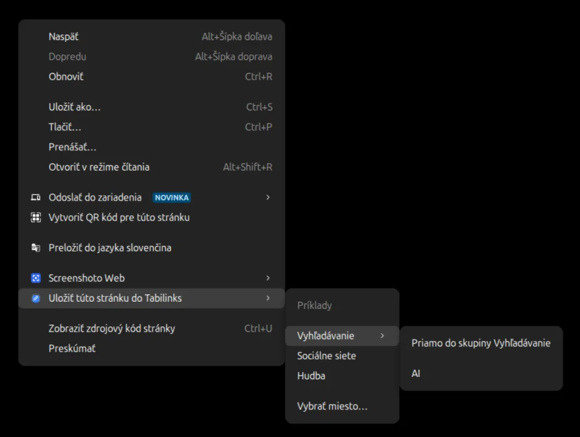
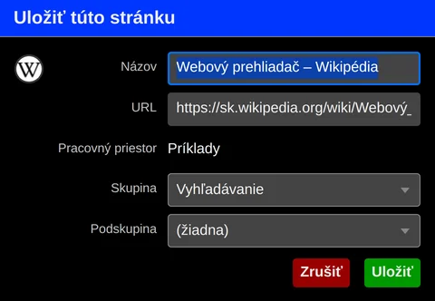

# Uložiť práve prezeranú stránku

Na uloženie práve prehliadanej stránky je možné použiť akciu kontextového menu **Uložiť túto stránku do Tabilinks**.

Alebo je taktiež možné nastaviť klávesovú skratku (vo väčšine prípadov aj premapovať predvolené CTRL + D).
Táto akcia si ale vyžaduje drobnú konfiguráciu, ktorá je popísaná tu: [Ukladanie stránok cez Ctrl+D](ctrl-d-saves-here.md)

Príklad rýchleho ukladania - nič nevypĺňate, odkaz sa uloží priamo do skupiny alebo podskupiny:

Štandardný ukladací dialóg, ktorý otvorí klávesová skratka alebo tlačidlo rozšírenia vo vrchnom paneli prehliadača:

