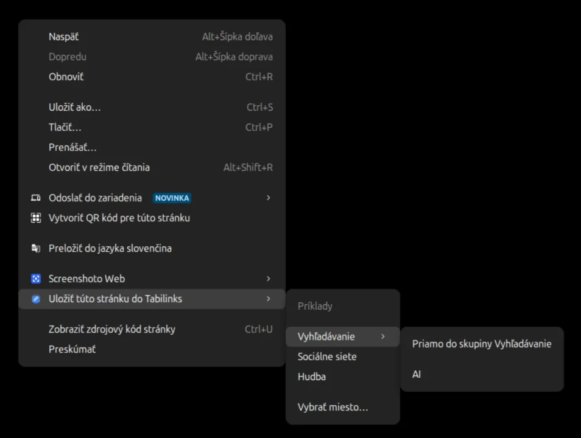
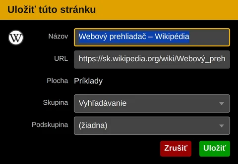

# Uložiť práve prezeranú stránku

Kliknite pravým tlačidlom na stránku, na ktorej práve ste - alebo na odkaz na nej - a otvorte položku **Tabilinks**. Ponúka tri spôsoby, ako si ju ponechať:

- **Rýchle uloženie** - uloží ju hneď, bez otázok, do skupiny „Rýchle uloženie“ v ploche, ktorú máte otvorenú. Skupina sa vytvorí pri prvom použití. Klávesová skratka je **Alt+Shift+F**. Viac v tipe [Rýchle uloženie: stránka jedným kliknutím](flash-save.md)
- **Pridať záložku…** - otvorí ukladacie okno, v ktorom zvolíte názov, plochu, skupinu aj podskupinu.
- **Uložiť do skupiny** - skupinu alebo podskupinu otvorenej plochy vyberiete priamo v ponuke a stránka sa tam uloží bez vypĺňania.

Zbierate odkazy rýchlo? V Nastaveniach → „Vzhľad a správanie“ prepnite „Akcie v kontextovej ponuke prehliadača“ na **Rýchle zbieranie odkazov**: Rýchle uloženie je potom v ponuke pravého tlačidla samo a priamo, na jedno kliknutie.

Ak v otvorenej ploche nie je miesto na ďalšiu skupinu, Rýchle uloženie nič neuloží a povie vám prečo.

Ukladacie okno sa otvorí aj tlačidlom rozšírenia v hornej lište prehliadača a jeho klávesovou skratkou (Alt+Shift+D, ak ste ju nezmenili). Otvárať ho môže dokonca aj Ctrl+D: [Ukladanie stránok cez Ctrl+D](ctrl-d-saves-here.md)

