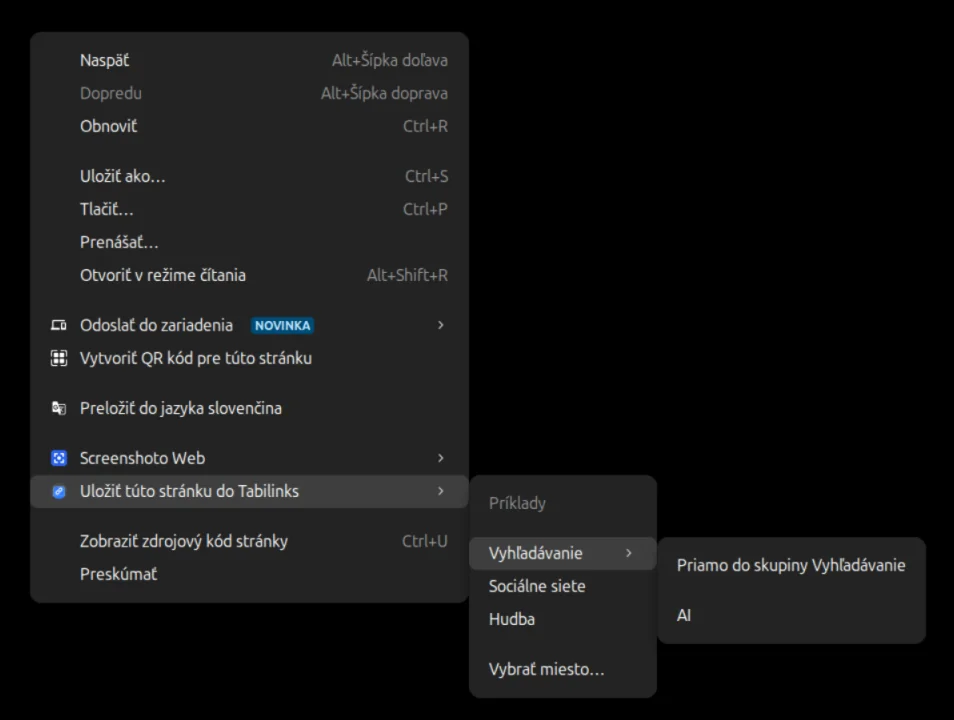
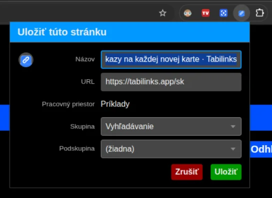

# Uložiť práve prezeranú stránku

Na uloženie práve prehliadanej stránky je možné použiť akciu kontextového menu **Uložiť túto stránku do Tabilinks**

Alebo je taktiež možné nastaviť klávesovú skratku (vo väčšine prípadov aj premapovať predvolené CTRL + D).
Táto akcia si ale vyžaduje drobnú konfiguráciu ktorá je popísaná tu: [Ukladanie stránok cez Ctrl+D](ctrl-d-saves-here.md)

Príklad rýchleho ukladania - užívateľ nevypĺňa nič, link je uložený priamo do skupiny alebo podskupiny: 

štandartný ukladací dialóg vyvolaný klávesovou skratkou alebo tlačidlom rozšírenia vo vrchnom paneli prehliadča:

