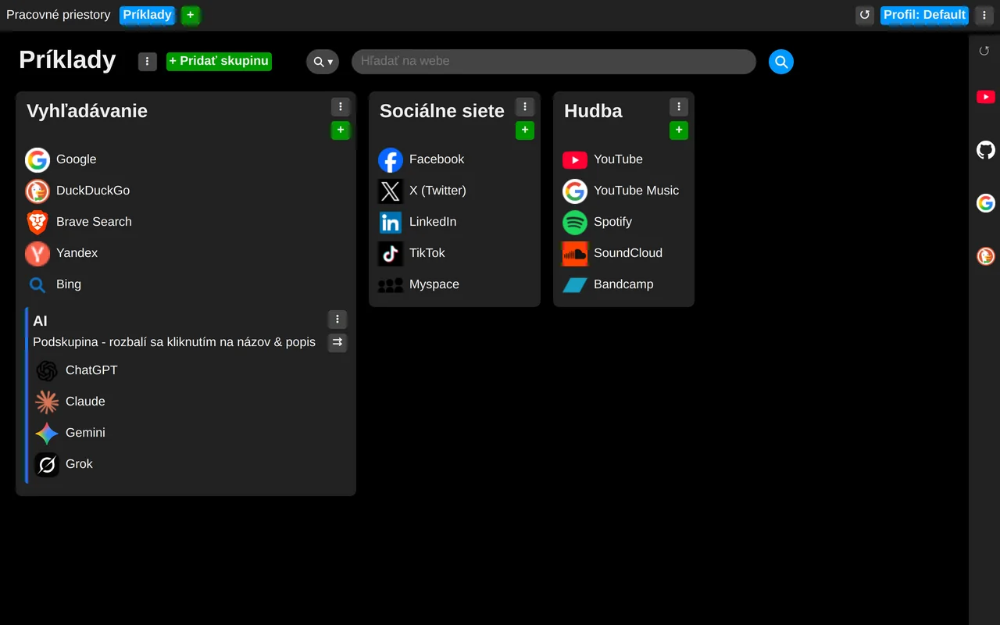
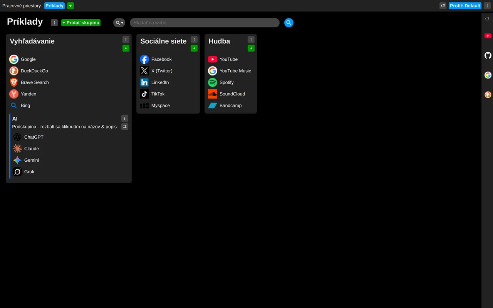

# Nastavenie veľkosti všetkého

Veľkosť prvkov rozhrania nastavíte v nastaveniach rozšírenia: v sekcii „Vzhľad a správanie“ posúvajte posuvník „Veľkosť“, kým nebude všetko tak, ako chcete.

Toto nastavenie sa nesynchronizuje a je uložené vždy pre konkrétny prehliadač.

Príklad 100 % veľkosť:

Príklad 75% veľkosť:

