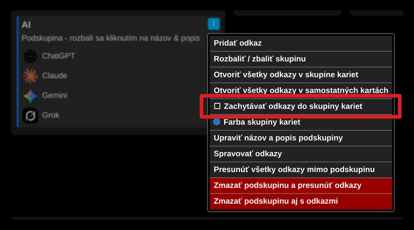
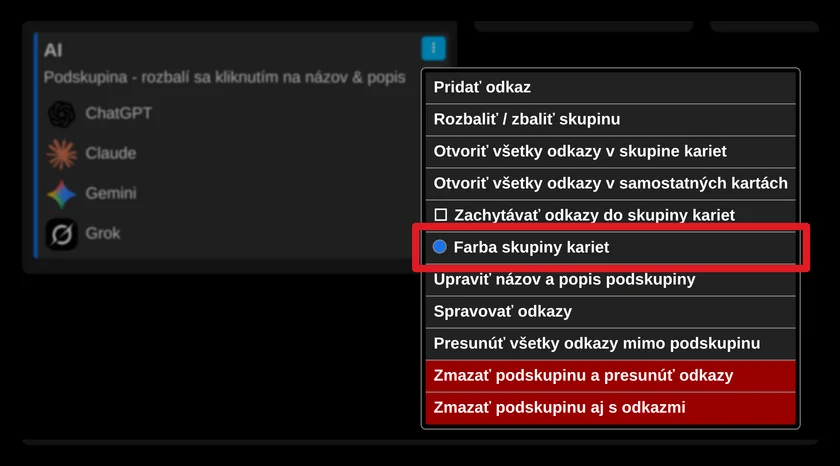

# Zachytávanie odkazov z podskupiny do skupiny kariet

Každú podskupinu môžete nastaviť tak, aby sa jej odkazy pri otvorení automaticky ukladali do skupiny kariet.

Toto nastavenie zapnete v ponuke podskupiny (ikona troch bodiek) zaškrtnutím „Zachytávať odkazy do skupiny kariet“.

Ak sa vám súčasná farba tejto skupiny kariet nepáči, môžete ju zmeniť cez „Farba skupiny kariet“.

Farba ľavého okraja podskupiny zodpovedá farbe skupiny kariet.

