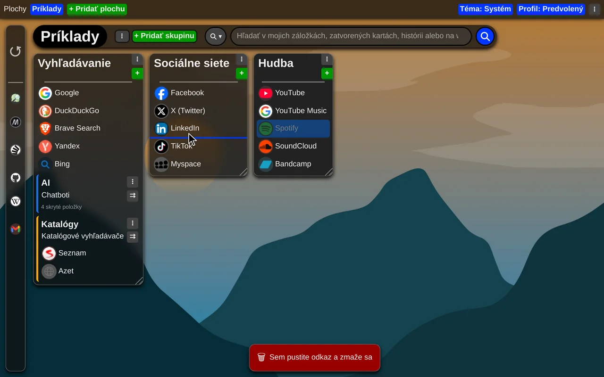
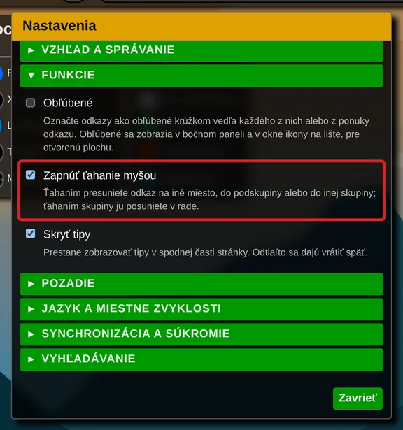

# Usporiadanie položiek ťahaním myšou

Skupiny, podskupiny aj odkazy si usporiadate myšou: chyťte položku a pustite ju tam, kde ju chcete mať.

Môžete:

- meniť poradie odkazov v skupinách a podskupinách
- presúvať odkazy medzi skupinami a podskupinami
- presúvať celé skupiny a podskupiny
- pretiahnuť zatvorenú alebo otvorenú kartu z bočného panela a uložiť ju do skupiny alebo podskupiny
- označiť odkaz ako obľúbený pustením na kartu Obľúbené v bočnom paneli (keď máte Obľúbené zapnuté)
- zmazať odkaz pustením na pruh v spodnej časti stránky, ktorý sa počas ťahania zmení na kôš

Ťahanie myšou je zapnuté od začiatku. Ak nechcete položky omylom presúvať, vypnete ho v nastaveniach rozšírenia, v sekcii „Funkcie“, odškrtnutím „Zapnúť ťahanie myšou“.

