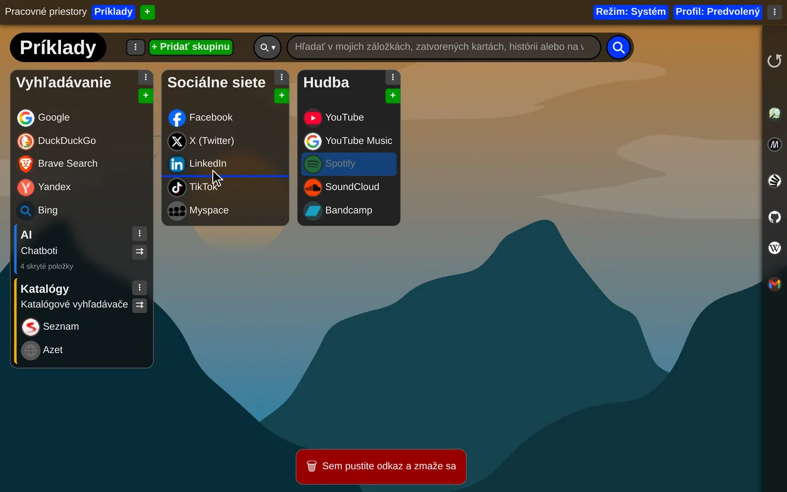
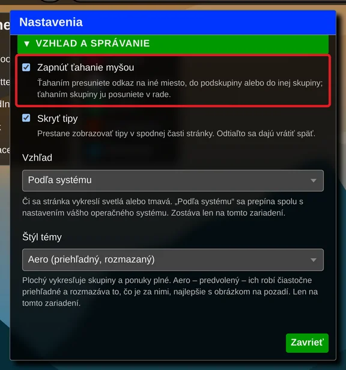

# Usporiadanie položiek ťahaním myšou

Skupiny, podskupiny aj odkazy si usporiadate myšou: chyťte položku a pustite ju tam, kde ju chcete mať.

Môžete:

- meniť poradie odkazov v skupinách a podskupinách
- presúvať odkazy medzi skupinami a podskupinami
- presúvať celé skupiny a podskupiny
- pretiahnuť odkaz z „Nedávno zavreté karty“ a uložiť ho do skupiny alebo podskupiny
- zmazať odkaz pustením na pruh v spodnej časti stránky, ktorý sa počas ťahania zmení na kôš

Ťahanie myšou je zapnuté od začiatku. Ak nechcete položky omylom presúvať, vypnete ho v nastaveniach rozšírenia, v sekcii „Vzhľad a správanie“, odškrtnutím „Zapnúť ťahanie myšou“.

