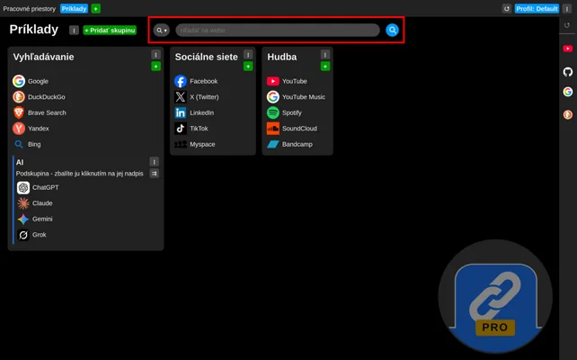

# Vyhľadávanie cez vyhľadávací riadok

Začnite písať a vyhľadávací riadok vám najprv ponúkne to, čo už máte, skôr ako čokoľvek pôjde na web:

- vaše **uložené odkazy** zo všetkých pracovných priestorov profilu,
- **otvorené karty** tohto prehliadača,
- vaše **zatvorené karty** a **históriu**,
- a nakoniec **vyhľadať na webe** to, čo ste napísali.

Vaše vlastné odkazy idú prvé a názov, ktorý začína tým, čo ste napísali, má prednosť pred takým, ktorý to len obsahuje. Šípkami sa v zozname posúvate; Enter otvorí zvýraznenú položku - prvú, ak sa neposuniete. Uložený odkaz, zatvorená karta alebo stránka z histórie sa otvorí v tejto karte; na otvorenú kartu sa prepnete.

Na vyhľadávanie na webe používa vyhľadávací riadok v predvolenom nastavení vyhľadávač vášho prehliadača.

Ak chcete použiť iný podporovaný vyhľadávač (Google, DuckDuckGo alebo Bing), jednoducho si ho vyberte z ponuky vedľa vyhľadávacieho riadka.

Toto nastavenie sa nesynchronizuje; pamätá sa iba v prehliadači, v ktorom ste ho nastavili.
